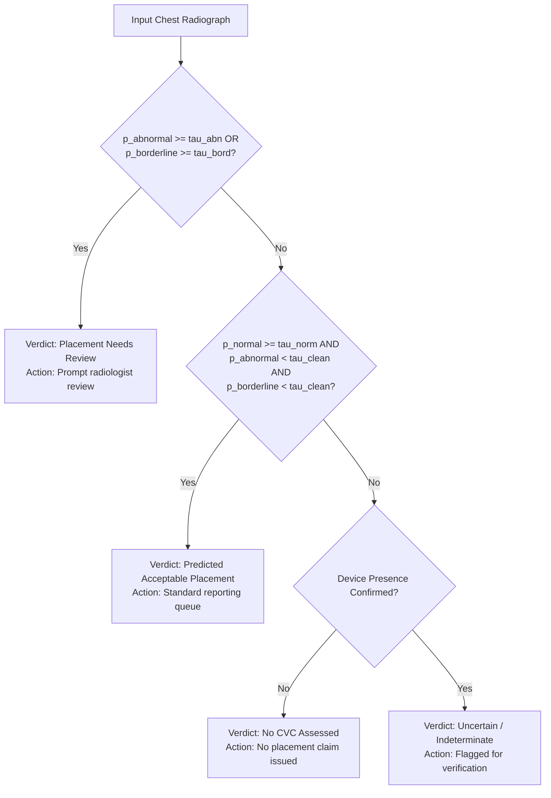

# CVC-Placement Classifier Diagnostic and Triage Audit Report (Corrected)

**Date**: 2026-10-16  
**Target**: CVC-Placement-V1 Diagnostic Evaluation (Work Item C)  
**Status**: Diagnostic Inspection Corrected; Unsupported Claims Retracted; Retraining Postponed  

---

## 1. Retraction of Unsupported Claims & Verified Root Causes

The previous diagnostic report reached unsupported conclusions due to flawed analysis scripts. This corrected report formally retracts those claims and replaces them with verified findings:

### A. Retraction: Claimed Patient Leakage Was Calculated on the Wrong Cohort
- **What happened**: The prior diagnostic script sliced rows `0:4000` and `4000:5000` of `study_inventory.parquet`. That was **not** how the classifier loaded data.
- **Actual implementation**: `CVCDataset` filters `classification_manifest.parquet` by `split == 'train'` and `split == 'model_selection'` before applying `iloc[:max_samples]`.
- **Reconstructed pilot subsets (4,000 train vs 1,000 selection)**:
  - **Patient ID overlap**: 0
  - **Study Instance UID overlap**: 0
  - **Recorded patient-group ID overlap**: 0
- **Correction**: There is **no patient leakage** between the pilot training and selection cohorts. The prior claim of 513 leaked patients is **retracted**.

### B. Genuine Distribution Shift (Prevalence Difference)
- There is a genuine label distribution difference between the splits:
  - **Training (4,000)**: Normal = 74.38%, Borderline = 25.70%, Abnormal = 9.43%.
  - **Selection (1,000)**: Normal = 60.30%, Borderline = 33.50%, Abnormal = 14.90%.
- Abnormal catheters occur in 9.43% of training cases versus 14.90% of selection cases.
- This warrants representative stratified sampling, but it does not represent patient leakage.

### C. Retraction: Claimed Excessive Positive Weight Was Not Used
- **What happened**: The prior script computed a hypothetical inverse-prevalence positive weight ($w \approx 8.2$) and reported it as an active training parameter that collapsed AUROC.
- **Actual implementation**: `CVCPlacementNet` in `placement_net.py` initializes `self.criterion = nn.BCEWithLogitsLoss()` with **no `pos_weight`**.
- **Correction**: The classifier was trained with standard unweighted BCE. The claim that `pos_weight` over-correction destroyed AUROC is **unsupported and retracted**.

### D. Audit Finding: 30,067 Manifest Rows Have Empty Image Hashes
- In `classification_manifest.parquet`, **30,067 out of 30,083 rows** have empty `sha256` string entries.
- Consequently, the manifest **does not currently establish the absence of byte-identical images** across splits.
- Real content hashes must be populated and verified before asserting complete split separation.

### E. Unresolved Root Cause of AUROC Failure (~0.548)
- The classifier's poor discrimination (~0.548 AUROC) remains an open engineering question.
- Hypotheses to test empirically on saved checkpoints and predictions (rather than assuming cause):
  1. Pretrained backbone BatchNorm drift on small micro-batches ($B \le 8$).
  2. Image-label alignment and crop artifacts.
  3. Extreme class imbalance without focal or ranking loss.

---

## 2. Reconstructed Pilot Cohort Comparison

| Partition | Total Studies | CVC - Normal (%) | CVC - Borderline (%) | CVC - Abnormal (%) | Patient Overlap |
| :--- | :---: | :---: | :---: | :---: | :---: |
| **Full Manifest** | 30,083 | 21,324 (70.88%) | 8,460 (28.12%) | 3,195 (10.62%) | Grouped |
| **Reconstructed Pilot Train** | 4,000 | 2,975 (74.38%) | 1,028 (25.70%) | 377 (9.43%) | **0 (None)** |
| **Reconstructed Pilot Selection** | 1,000 | 603 (60.30%) | 335 (33.50%) | 149 (14.90%) | **0 (None)** |

---

## 3. Repaired Clinical Triage Decision Contract

### A. Corrections to Triage Logic
1. **Never sum multi-label probabilities**: The expression $p_{\text{norm}} + p_{\text{bord}} + p_{\text{abn}}$ does not represent a calibrated CVC-presence probability because the classes are non-exclusive multi-labels.
2. **Retraction of 'Zero False Reassurance Guarantee'**: Requiring normal evidence reduces unwarranted pass-through, but no algorithm can guarantee zero false reassurance. Residual false reassurance must be measured empirically.
3. **Predictor and evaluator alignment**: Both predictor and evaluator must implement the exact same 4-state policy.

### B. Formal Four-State Triage Definitions:
1. **`Placement Needs Review`** (`review`):
   - Condition: $p_{\text{abnormal}} \ge \tau_{\text{abnormal}}$ OR $p_{\text{borderline}} \ge \tau_{\text{borderline}}$.
   - Prioritizes high sensitivity to unsafe catheter positioning.

2. **`Predicted Acceptable Placement`** (`acceptable`):
   - Condition: $p_{\text{normal}} \ge \tau_{\text{normal}}$ **AND** $p_{\text{abnormal}} < \tau_{\text{clean_abnormal}}$ **AND** $p_{\text{borderline}} < \tau_{\text{clean_borderline}}$.
   - Must NOT be assigned simply because review was not triggered (`~pred_review`). Positive evidence of normal anatomy is mandatory.

3. **`No CVC Assessed`** (`no_assessment`):
   - Condition: Assigned when radiograph lacks evidence of CVC presence (e.g. from catheter segmentation mask or independent presence detector).
   - Prevents uncatheterized radiographs from receiving an acceptable placement verdict.

4. **`Uncertain / Indeterminate`** (`uncertain`):
   - Condition: Neither meeting acceptable evidence criteria nor crossing review thresholds, or within defined uncertainty margin.
   - Routed to clinical verification rather than passing silently.

---

## 4. Status & Next Steps

- Classifier retraining remains **postponed** until the segmentation paired pilot (512 vs 768) is completed.
- When classifier work resumes, it must:
  1. Compute and verify SHA256 image hashes across all manifest rows.
  2. Use stratified group sampling matching natural label prevalence.
  3. Empirically inspect BatchNorm running statistics and prediction distributions.
  4. Evaluate under the unified 4-state triage function measuring residual false reassurance.
